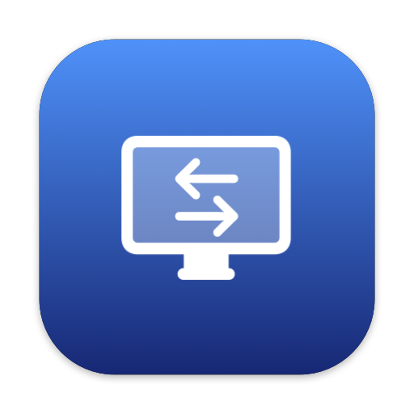
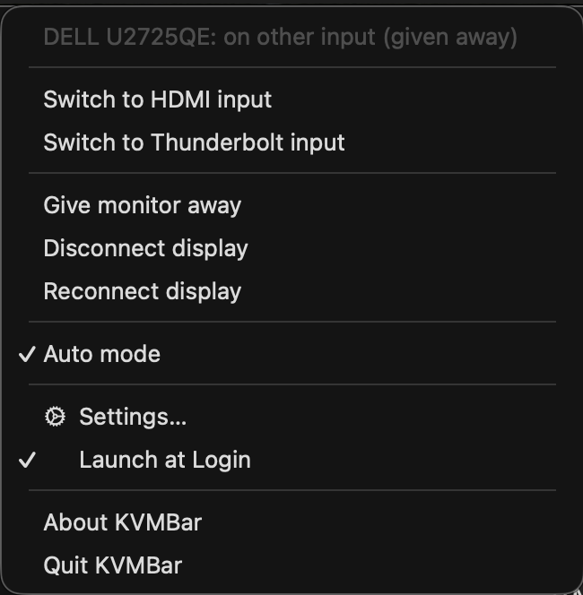
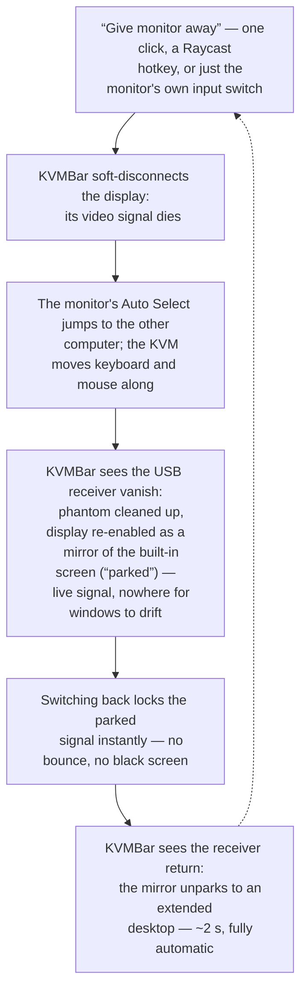

<p align="center">
  
</p>

<h1 align="center">KVMBar</h1>

<p align="center">
  One monitor, two Macs, zero pain: a menu bar KVM helper that hands your display<br>
  and peripherals to the other computer in one click — or fully automatically.
</p>

<p align="center">
  
  
  
  
</p>

---

Built for a Dell U2725QE shared between two MacBooks; useful for any monitor
with a built-in KVM switch.

```bash
git clone https://github.com/wishval/KVMBar.git
cd KVMBar && make install
```

<p align="center">
  
</p>

## The problem

A KVM monitor moves the USB hub (keyboard/mouse) when you switch inputs, but
on the Mac side two things go wrong:

1. **Phantom display** — when the monitor switches to the other Mac's input,
   the Thunderbolt/HDMI link often does *not* drop, so macOS keeps treating the
   display as connected: windows and the cursor drift onto an invisible screen.
2. **Black screen on return** — when the monitor switches back, macOS
   sometimes doesn't re-issue the video stream.

## The loop KVMBar automates



## Features

- **One-click give-away** (menu, CLI, Raycast) — display and peripherals move
  to the other computer, macOS-side mess is cleaned up automatically.
- **Fully automatic mode**: the monitor's KVM physically moves your wireless
  receiver between computers together with the video, so its USB
  presence/absence is a perfect hardware "who owns the monitor" signal —
  tracked via IOKit notifications, no polling, works even when you switch
  with the monitor's own buttons.
- **Mirror parking**: while the monitor is away, the given-away display is
  kept as a harmless mirror of the built-in screen — instant switch-back,
  no phantom side effects.
- **Soft disconnect / reconnect** of the external display (SkyLight private
  API) for manual phantom cleanup and black-screen fixes; the display ID is
  persisted so reconnect works while the display is offline.
- **Native DDC layer** on Apple Silicon (IOAVService I2C, ported from the
  MIT-licensed [m1ddc](https://github.com/waydabber/m1ddc)) — diagnostics
  (`--status` reads the monitor's registers) and input switching for monitors
  that honor it.
- **Monitor auto brightness** toggle (menu checkmark, CLI) — the monitor's
  own ambient-light sensor, switched over DDC (VCP `0x66`) without touching
  the OSD.
- Menu bar icon reflects state at a glance, optional notifications on auto
  actions, launch at login (`SMAppService`), CLI mode for Raycast hotkeys.

## Build

Requires Xcode command line tools (Swift 5.9+), macOS 13+. No dependencies,
no sandbox, no notarization — a personal tool built from source:

```bash
make build      # -> dist/KVMBar.app (ad-hoc signed)
make install    # -> /Applications/KVMBar.app
make run
```

Build it **on each Mac** (copying the app between machines adds a quarantine
flag and the ad-hoc signature is machine-local anyway).

On the second Mac, open Settings from the menu and swap the inputs
(e.g. *my input = HDMI / 17*, *other = Thunderbolt / 25*).

## CLI (Raycast / scripts)

The same binary is the CLI. If the menu bar app is running, commands are
forwarded to it (via `DistributedNotificationCenter`) so the icon stays in
sync; otherwise they execute directly.

```bash
KVMBAR=/Applications/KVMBar.app/Contents/MacOS/KVMBar
"$KVMBAR" --status              # read-only diagnostics
"$KVMBAR" --give-away           # hand monitor + USB to the other computer
"$KVMBAR" --reconnect           # fix a black screen / re-enable / unpark
"$KVMBAR" --disconnect          # soft-disconnect only
"$KVMBAR" --switch-input 17     # code, configured name, "mine" or "other"
"$KVMBAR" --auto-brightness on  # monitor's own auto brightness: on|off|toggle
```

Raycast script command example:

```bash
#!/bin/bash
# @raycast.schemaVersion 1
# @raycast.title Give monitor away
# @raycast.mode silent
/Applications/KVMBar.app/Contents/MacOS/KVMBar --give-away
```

## How it works

### Soft disconnect (SkyLight)

The private SkyLight framework exports `SLSConfigureDisplayEnabled`. On
modern macOS its first parameter is a **display-configuration transaction**,
not a connection ID — the call must be staged between the public
`CGBeginDisplayConfiguration` / `CGCompleteDisplayConfiguration`:

```c
CGError SLSConfigureDisplayEnabled(CGDisplayConfigRef config,
                                   CGDirectDisplayID display, bool enabled);
```

The widely circulated `(cid, displayID, enabled)` variant segfaults inside
`checkCapacity(CGSConfigData*)` on macOS 26 — we learned this from a crash
report, so you don't have to. The symbol is resolved via `dlopen`/`dlsym`;
if a macOS update changes it again, KVMBar degrades to a menu warning
instead of crashing.

Disabling a display removes it from the desktop even though the physical
link stays up (kills the phantom); enabling forces a fresh modeset (cures
the black screen).

### DDC on Apple Silicon (IOAVService)

There is no documented DDC path on Apple Silicon. KVMBar finds the
`DCPAVServiceProxy` IORegistry entry with `Location = External`, wraps it in
an `IOAVService` (`IOAVServiceCreateWithService`, exported by CoreDisplay),
and exchanges DDC/CI packets at I2C chip address `0x37` / data address
`0x51` — exactly what m1ddc does.

### U2725QE findings (measured on real hardware)

The U2725QE needs **no DDC control at all** — and that's lucky, because it
ignores it: input select (VCP `0x60`) and the vendor KVM codes
(`E5/E7/E8/EA`) are ACKed and echoed back on reads, but switch nothing (all
control lives in Dell's own DDPM channel). The read reply's high byte is a
static per-port identity (always `0x19` on the TB port), so it can't be used
as a "current input" probe either. DDC reads work over TB/USB-C and are
entirely dead through the MacBook's **built-in HDMI port** (its internal
DP→HDMI converter swallows DDC/CI).

Hence the flow in the diagram above: soft-disconnect + the monitor's own
*Auto Select* (must be On in the OSD — factory default) + the USB receiver
as the ownership signal. No DDC in the critical path, which is also why it
works identically from the HDMI-connected Mac.

One DDC feature the U2725QE *does* honor: VCP `0x66` (MCCS *Ambient light
sensor*), i.e. the OSD's *Auto Brightness* — that is what the *Monitor auto
brightness* menu item toggles. The low nibble follows the spec (`1` = off,
`2` = on; writing `2` visibly hands brightness to the sensor within seconds).
The high nibble carries undocumented Dell flags (`0x91` off / `0x92` on as
shipped; clearing bit `0x80` makes the auto level much darker), so KVMBar
reads the value first and rewrites only the MCCS nibble. Its capabilities
string lists the feature as `66(00F2)`.

## Settings

Everything lives in `UserDefaults` suite `dev.valerii.kvmbar.shared` (shared
between the app and CLI) and applies immediately — no Save button. The ones
that matter:

- **Inputs** — names and DDC codes for both sides (swap them on the second
  Mac).
- **KVM device vendor/product ID** — which USB device to treat as the KVM
  anchor. Find yours in System Information → USB while the receiver is
  plugged into the monitor.
- **Mirror parking** toggle and delay (how long after give-away to wait
  before parking; the monitor must settle on the other input first).
- **“Switch to other input” gives the monitor away** (on by default) — the
  away-switch runs the whole handoff → soft-disconnect → park sequence, so it
  is one click instead of two. Turn it off to get a bare DDC input write plus
  a separate *Give monitor away* menu item.
- **“Switch to my input” reconnects the display** (on by default) — after
  the input switch the display is reconnected the same way *Reconnect
  display* does it: the parked mirror is unparked to an extended desktop, a
  disabled display is re-enabled, an active-but-black one gets a video
  refresh. Without it the monitor usually came back as a duplicate of the
  built-in screen and *Reconnect display* had to be clicked by hand.

Legacy/experimental toggles (DDC input probe, phantom watch, blind return
probe, Dell E8 handoff) are off by default and only useful on monitors that
honor DDC properly.

## Finding DDC input codes for other monitors

U2725QE (from its own DDC capabilities): **Thunderbolt = 25, HDMI = 17,
DisplayPort = 15**. Older Dells (U2723QE etc.): USB-C = 27, HDMI 1 = 17,
HDMI 2 = 18, DP = 15. To discover yours: `KVMBar --status` prints the raw
VCP `0x60` value, or use [m1ddc](https://github.com/waydabber/m1ddc) /
`ddcutil capabilities` on Linux — the capabilities string lists the supported
values for VCP `60`.

## Known risks & limitations

- **Private APIs.** `SLS*` and `IOAVService*` are undocumented and can change
  in any macOS update. KVMBar resolves them at runtime and degrades to a menu
  warning; behavior verified on macOS 26.5.
- **Ad-hoc signing.** After every rebuild the code signature changes; if
  Launch at Login stops working after an update, toggle it off/on once.
- **Clamshell.** KVMBar refuses to disable the display if it's the only
  active one (you'd end up with a headless Mac). Keep the lid open when
  giving away.
- **Multiple externals.** The first non-builtin display is used; a warning is
  logged.
- Notifications and Launch at Login only work from the `.app` bundle. macOS
  may refuse notification authorization for ad-hoc-signed apps — install to
  `/Applications` and enable KVMBar under System Settings → Notifications,
  or just ignore; everything else works without them.

## Debugging

```bash
log stream --predicate 'subsystem == "dev.valerii.kvmbar"' --level debug
```

Categories: `app`, `menu`, `display`, `watcher`, `ddc`, `skylight`, `cli`,
`notify`, `login`.

## License & author

MIT — see [LICENSE](LICENSE).

Made by Valerii Bakalenko —
[valeriy.bakalenko@gmail.com](mailto:valeriy.bakalenko@gmail.com) ·
[linkedin.com/in/valerii-bakalenko](https://www.linkedin.com/in/valerii-bakalenko/) ·
[github.com/wishval](https://github.com/wishval)
